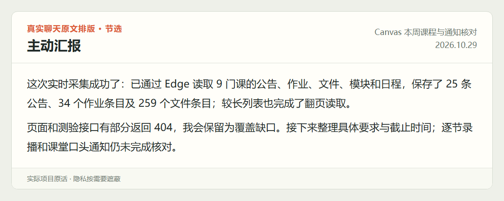

<div align="center">

# 八荣八耻.skill

### 给你的 Agent 装上八荣八耻。

**主动汇报 · 逐条验收 · 额度收尾**

一个把做事标准写进 `AGENTS.md` 的 Agent skill。

[看实际记录](#干活有交代长这样) · [一分钟看懂](#一分钟看懂) · **[直接启用](#直接启用)** · [为什么重新写八条](#为什么重新写这八条)

</div>

<p align="center">
  <picture>
    <source media="(max-width: 600px)" srcset="assets/principles-mobile.png" />
    
  </picture>
</p>

<details>
<summary>展开八条文字版，方便复制</summary>

1. 以误认目标为耻，以明确成效为荣。
2. 以无据断言为耻，以查证求实为荣。
3. 以闭门造轮为耻，以择优复用为荣。
4. 以照单全收为耻，以独立判断为荣。
5. 以表面达标为耻，以实物验收为荣。
6. 以无声中断为耻，以有据续作为荣。
7. 以无效消耗为耻，以及时收敛为荣。
8. 以黑箱推进为耻，以主动汇报为荣。

</details>

## 干活有交代，长这样

下面选自本人 2026-10-29 的实际项目聊天，保留原话，按原文排版；隐私已遮挡。

### 进展主动说

做了什么、遇到什么、下一步查什么，不用一直追问。

<picture>
  <source media="(max-width: 600px)" srcset="assets/records/progress-mobile.png" />
  
</picture>

### 八条逐项交代

正常报告之后，用完整八条解释本次怎么做、拿什么验、还有哪里没做到。

<picture>
  <source media="(max-width: 600px)" srcset="assets/records/eight_principles-mobile.png" />
  
</picture>

### 额度到了，先把话交代完

提前保存成果和下一步，交一份人能接着看的收尾报告。

<picture>
  <source media="(max-width: 600px)" srcset="assets/records/quota_closeout-mobile.png" />
  
</picture>

[查看可复制原文与记录说明 →](docs/examples/real-work.md)

## 一分钟看懂

| 你想知道的 | 直接说 |
| --- | --- |
| **这是什么？** | 一套 Agent 工作规矩，包含 skill、长期规则和额度交接工具。 |
| **解决什么？** | 做偏方向、凭空断言、闷头造轮、表面交差，以及额度耗尽后没交接。 |
| **体验怎么变？** | 授权内自己判断；进度主动说；结果按八条交代；接近额度线先收尾。 |
| **会改哪里？** | 安装项目 skill，并备份、合并 `AGENTS.md` 中的专属规则块。原有其他内容保留。 |
| **怎样直接用？** | 复制下面的提示词，或者运行一条安装命令。 |
| **适合谁？** | 能读写文件、调用工具的 Codex / Claude Code 等 Agent；复杂任务更能用上。[能力与型号](docs/compatibility.md) |

## 直接启用

### 发给 Agent，让它代办

```text
帮我在当前项目安装并启用 https://github.com/Cyh29hao/eight-honors-skill 。
先读 README，用 scripts/install.py 安装 skill、备份并合并项目规则。
保留我的其他规则；有冲突就说明，不覆盖自定义修改。
完成后告诉我改了哪些文件，并确认新会话能读到这套约定。
```

### 或者，运行一条命令

在项目根目录运行，需要 **Python 3.9+**。这条命令下载并执行本仓库的[开源安装脚本](scripts/install.py)：

```sh
python -c "import urllib.request as u;exec(u.urlopen('https://raw.githubusercontent.com/Cyh29hao/eight-honors-skill/main/scripts/install.py',timeout=20).read(262144))"
```

它会安装到 `.agents/skills/eight-honors`，先备份已有规则，再合并 `AGENTS.md`。重复运行不重复追加；发现自定义修改会保留并停止。加 `--dry-run` 可先看会改什么。

安装后开一个新会话，输入 `$eight-honors`。Claude Code 在命令末尾加 `--agent claude`，调用 `/eight-honors`。[手动安装、备份与更新 →](docs/installation.md)

## AGENTS.md 里多了什么

**八条做事原则、主动汇报与尾部八条格式、长任务额度收尾与交接约定。** 规则放在单独的标记块里，方便查看和调整：

```markdown
<!-- EIGHT-HONORS:START -->
## 八荣八耻工作约定
```

[查看实际写入的完整规则 →](references/AGENTS.fragment.md)

小任务直接完成，纯问答不附八条。想改成“只在阶段结束附八条”，在项目规则里写明即可。**Skill 放方法和工具，`AGENTS.md` 放你希望一直沿用的偏好。**

**为什么默认剩余 30% 就收尾？** 我使用 Plus 时，通常还要看结果、反馈，再改几轮。这个余量是留给人工验收与后续对话的，减少到最后才收敛留下的半成品和重讲成本。它是我的个人默认，你可以改成 10% 或其他数值。[在哪调整 →](docs/customization.md)

额度查询依赖已登录的 Codex CLI；自动接续需要宿主支持的调度机制。[额度与接续说明 →](references/quota-and-recovery.md)

## 为什么重新写这八条

AI 编程八荣八耻早就流行过。我重新写它，是因为 Agent 接手的工作已经从改代码扩展到报告、研究、视频和整段项目：光管“别乱改”，还不够。

当时我在聊天里提出：

> 我说的不一定对，可能只是提供一个示例或者方向，如果你一味执行而不做质疑或者自主变通则会出现问题

所以这版把**目标与方法分开**：目标和硬约束要守住，具体做法要会判断；把**查证与验收分开**：说得有根据，还要东西真能用；把**接续与消耗分开**：既要留得下进度，也要知道什么时候换路、收工。

另一个要求更直接：

> 绝对不能出现额度耗尽却没有给我看的报告总结式输出的现象

这才有了现在的八个职责：**目标、证据、复用、判断、验收、接续、成本、沟通。** 本领交给模型继续长，工作规矩先立起来。

[原始讨论的设计脉络](docs/design-origin.md) · [来源与借鉴](docs/provenance.md) · [验证记录](docs/validation.md)

---

By [Cyh29hao](https://github.com/Cyh29hao) · [水仙.skill](https://github.com/Cyh29hao/shuixian-skill) · [小红书分享素材](docs/sharing.md) · [English](README_EN.md) · MIT License
