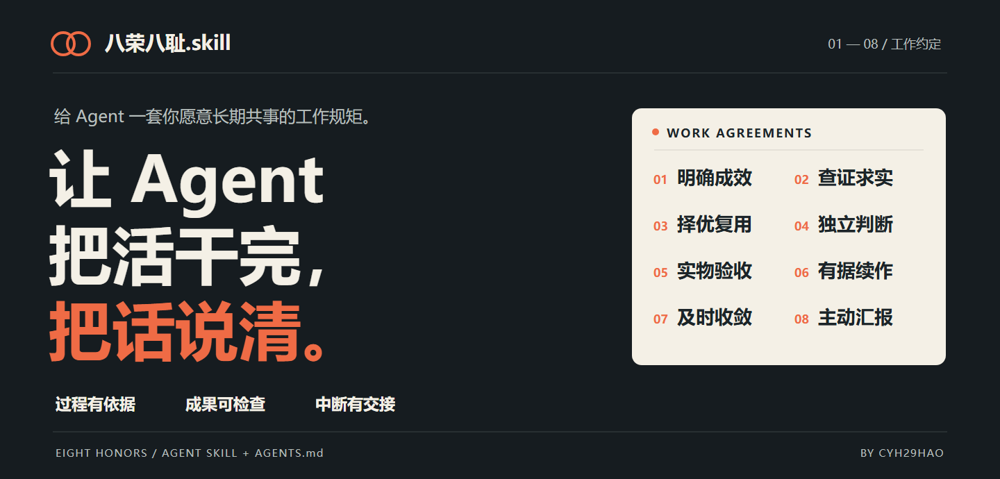

<div align="center">

# 八荣八耻.skill

### 给 Agent 一套你愿意长期共事的工作规矩。

认准目标 · 拿出证据 · 验收成果 · 中断交接

**[让 Agent 帮你安装](#让-agent-帮你开始)** · [八条原文](#八条原文各管一件事) · [看工作报告](#用了以后工作报告长什么样) · [长期写进 AGENTS.md](#skill-与-agentsmd怎么搭配) · [调整偏好](docs/customization.md) · [English](README_EN.md)


</div>

<p align="center">
  <picture>
    <source media="(max-width: 600px)" srcset="assets/hero-mobile.png" />
    
  </picture>
</p>

你可能遇到过：它答应得很快，做偏了方向；代码能编译，实际页面却不好用；一连串工具调用以后，只剩一句“已完成”；额度到了，进度也断了。

**我把自己与 Agent 长期协作时反复纠正的这些问题，整理成了八条工作约定。** 这也是我的管理偏好：明确目的，给执行者判断空间，用真实成果验收，让过程与交接说得清楚。

它包含可安装的 `SKILL.md`、可合并的 `AGENTS.md` 片段、报告范例，以及 Codex 的只读额度查询和交接工具。小修改直接做，复杂任务再增加必要流程。

> **“八荣八耻”早已有过一轮传播。** 社区已有围绕接口、复用、测试与重构的[编程版原文](https://github.com/langbot-app/LangBot/blob/master/AGENTS.md)，也已有[同概念 skill](https://github.com/wangcangxing/ai-eight-honors-eight-shames)。这一版是我对协作方式的重新整理；不主张首创，也没有“成功率提升 X%”的对照数据。[来源、借鉴与区别 →](docs/provenance.md)

## 八条原文，各管一件事

| | 我的八荣八耻 | 它负责管什么 |
| :---: | --- | --- |
| 01 | **以误认目标为耻，以明确成效为荣。** | 认准目的、受众与不能改变的条件 |
| 02 | **以无据断言为耻，以查证求实为荣。** | 分清事实、推断与不知道 |
| 03 | **以闭门造轮为耻，以择优复用为荣。** | 先找成熟方案，再决定采用、改造或自建 |
| 04 | **以照单全收为耻，以独立判断为荣。** | 授权内自己判断，发现建议不合适就说明 |
| 05 | **以表面达标为耻，以实物验收为荣。** | 检查真实产物能否达到用途 |
| 06 | **以无声中断为耻，以有据续作为荣。** | 提前收尾，留下成果、缺口和准确下一步 |
| 07 | **以无效消耗为耻，以及时收敛为荣。** | 无效路线及时换，必要检查通过就停止扩展 |
| 08 | **以黑箱推进为耻，以主动汇报为荣。** | 让用户看见进度、关键取舍与限制 |

“荣耻”是便于记住的说法。实际执行靠具体约定、工具和检查；一段规则不能保证模型永远做对。

## 这一版具体改变什么

| 经常发生的事 | 这套约定要求 Agent 怎么做 |
| --- | --- |
| 把用户随口举的例子当硬要求 | 分清目的、偏好、候选方法和事实估计；授权内主动选择合适做法 |
| 搜过几个项目，就说“已择优复用” | 说清实际看过哪些候选、采用哪部分、舍弃原因，及必须自建的内容 |
| “导出成功”“测试通过”就宣布完成 | 对照用途检查成品：页面要看与点，文档要渲染，任务要看真实结果 |
| 工具一直在跑，用户不知道发生了什么 | 在发现、改向、阻塞和阶段结束时主动说状态；正文后逐条解释八条体现 |
| 额度快耗尽，还要启动下一大步 | 读实时余额，预留收尾空间，保存最完整成果与交接，先把未完成报告交给人 |
| 写了一个 checkpoint，就说会自动恢复 | 分别说明保存、调度、触发和实际执行；没有唤醒机制就明确“未启用” |
| 为了“严谨”，小改动也开一套庞大流程 | 按任务规模工作；失败条件不变时不重试，相关检查通过后收敛 |

这些是可观察的行为要求；实际效果仍取决于模型、宿主工具、任务和执行情况。它不会赋予 Agent 原本没有的权限、视觉或定时运行能力。

一次真实小任务试用：用户猜“float 精度有问题”，独立 Agent 复现后发现其实是取消订单被计入，复用项目已有函数，将合成示例的导出从 **120.00 修为 20.00**，5 组入口检查通过，并交付八条说明。[查看任务、实际报告和复现代码 →](docs/experiments/2026-10-29-forward-test.md) 这是一例行为记录，没有未加载 skill 的对照组。

## 让 Agent 帮你开始

把下面的话发给能读写本机文件的 Agent：

```text
帮我安装 https://github.com/Cyh29hao/eight-honors-skill ，在当前项目使用。
先读 README 和 SKILL.md，保留我已有的规则与文件。
按八荣八耻完成任务：先理解目标，用实际成果验收，主动说明进度，
工作报告正文之后逐条说明八条体现。小任务直接做。
如果有 Codex 额度查询能力，长任务提前检查并留出收尾空间；
没有调度工具时，要明确自动恢复未启用。
```

先在一个项目试用即可。**只安装 skill，并不等于每一轮都一定自动加载。** 希望长期贯彻时，再合并下方的 `AGENTS.md` 片段。

### 手动安装：Codex

在准备工作的项目目录运行，需要 Git；额度工具另需 Python 3.9+ 和已登录的 Codex CLI。

```sh
git clone https://github.com/Cyh29hao/eight-honors-skill .agents/skills/eight-honors
```

在同一项目调用：

```text
$eight-honors
请按这套工作约定完成当前任务，交付成果、证据与八条体现。
```

这是项目级安装；未出现在可用 skill 中时，重新打开项目或启动新会话。已有同名目录时 `git clone` 会停止，先核对旧安装，不要直接删除。全局安装、规则合并与卸载见[安装指南](docs/installation.md)。

### 其他 Agent

支持 Agent Skills 格式的宿主可加载本仓库根目录的 `SKILL.md`。Claude Code 可把同一仓库放入 `.claude/skills/eight-honors`，调用 `/eight-honors`；其持久规则入口通常是 `CLAUDE.md`。这是按其[官方 Skills 文档](https://code.claude.com/docs/en/skills)提供的接入方式，本次未做 Claude Code 实机验收。其他宿主须核对自己的加载目录与工具；Codex 额度适配器不通用于其他服务。

## Skill 与 AGENTS.md，怎么搭配

**Skill 负责可复用的方法和工具，`AGENTS.md` 负责每次开工时带上的工作约定。** Codex 的默认文件名是 **`AGENTS.md`**，有 S；`Agent.md` 需要另行配置才能被当作规则文件。

| 我想怎样用 | 放在哪里 | 得到什么 |
| --- | --- | --- |
| 只在本次任务使用 | 调用 `$eight-honors` | 按需读取规则、范例和额度工具 |
| 这个项目长期如此 | 合并 [AGENTS.fragment.md](references/AGENTS.fragment.md) 到项目 `AGENTS.md` | 新会话带入该项目的协作偏好 |
| 所有项目沿用偏好 | 合并到 `$CODEX_HOME/AGENTS.md`，未设置则 `~/.codex/AGENTS.md` | 全局默认，项目仍可补充或覆盖 |
| 不安装脚本，只借工作风格 | 仅合并片段 | 目标、证据、验收和报告约定；不声称已监控额度 |

请合并 `EIGHT-HONORS:START/END` 标记块，保留自己的其他内容；不要拿整份文件覆盖原配置。已有同一套八条时先消除重复和冲突。`AGENTS.override.md`、项目层级和指令体积也会影响加载，见[接入细节](docs/installation.md)。以上依据 [Codex 规则文档](https://learn.chatgpt.com/docs/agent-configuration/agents-md)与 [Skills 文档](https://learn.chatgpt.com/docs/build-skills)。

## 用了以后，工作报告长什么样

下面是**设计示例**，不是一次真实修复记录：

> 已修复手机上提交按钮被底栏遮挡的问题。两个浏览器视口中可见、可点击；桌面布局已检查，实体手机尚未验证。
>
> ……正文之后的八条附录节选……
>
> 3. **以闭门造轮为耻，以择优复用为荣**：采用了项目已有的安全区域样式，没有新增布局库。
> 5. **以表面达标为耻，以实物验收为荣**：实际检查了显示和点击结果；实体手机仍有验证缺口。
> 7. **以无效消耗为耻，以及时收敛为荣**：相关检查通过后停止，没有扩大成全站改版。

实际默认附录保留完整 1–8 条标题，每条写本次具体事实；未涉及或未验证可以直说。纯问答、闲聊不套工作报告。值得细读的对应条目才在标题后标注“（重要）”，标记只出现在尾部八条里。不强制自评分。[完整八条范例 →](references/reporting.md)

## 额度快到了，怎样收尾

```text
实时查询 → 预留收尾空间 → 保存成果 → 最小验证 → 交付未完成报告
                                                   ↓
                      已有授权＋真实调度工具，才安排并核验恢复
```

附带的 Python 工具只使用标准库，调用 Codex App Server 的只读 `account/rateLimits/read`。默认五小时剩余 **≤30%** 进入收尾；周剩余 **≤30% 只提示**，周耗尽则收尾。查不到就报告 `UNKNOWN`，不猜百分比。

```sh
python .agents/skills/eight-honors/scripts/check_codex_quota.py --json
```

工具提供 `admit` 阶段预留建议、`save` 原子保存交接和 `resume` 读取历史。**`resume` 不运行命令，这个仓库也未内置自动唤醒器。** 规则促使 Agent 提前收尾，不能强制拦截宿主请求。突然断网、进程终止或平台拒绝仍可能打断最后输出。[命令、阈值和恢复条件 →](references/quota-and-recovery.md)

## 在哪里调整

| 要调整的偏好 | 编辑哪里 |
| --- | --- |
| 八条原则、执行边界、默认报告行为 | [SKILL.md](SKILL.md) |
| 项目长期偏好、报告频率、本项目验收要求 | 已合并的项目 `AGENTS.md` 标记块 |
| 报告语气、详略与示例 | [references/reporting.md](references/reporting.md)；实际要求同步改 `SKILL.md` 或 `AGENTS.md` |
| 额度收尾阈值 | 明确告诉 Agent，并传 `--five-hour-closeout-percent N` |
| 调度方式与可用工具 | 宿主自动化设置；本仓库没有通用配置开关 |
| Skill 列表显示名与默认提示 | [agents/openai.yaml](agents/openai.yaml) |

不用八条附录的频率？可以改成只在阶段结束出现。没有视觉工具？先补足验收能力，别让模型口头宣称看过。更轻的配置和回滚办法见[调整指南](docs/customization.md)。

## 适合什么能力、什么型号的 Agent

先看宿主能做什么，再选模型。

| 能力层级 | 适合怎样使用 | 做不到什么 |
| --- | --- | --- |
| 只能聊天 | 使用八条作为思考与回答约定 | 无法验证本机产物、运行脚本或长期修改规则 |
| 可读写文件、运行工具、有可靠指令遵循能力 | 使用完整 skill，完成研究、代码、文档等任务 | 无图片查看能力时不能验收视觉质量 |
| 另有已登录 Codex CLI 和 Python | 增加真实额度查询、阶段建议与交接工具 | 查询与保存仍不等于自动恢复 |
| 另有宿主调度、持久状态与授权 | 可安排跨窗口接续并验证触发 | 依赖机器、应用、权限与服务的实际运行条件 |

按 **2026-10-29 查阅的官方定位**，Codex 中的 GPT-6.1 Sol 可作为长任务候选，GPT-6 Astra 可用于更难的判断任务，GPT-6.1 Terra 偏写作、视觉与应用操作，GPT-6 Luna 可先用于范围清楚的小任务。**这不是本 skill 的跨型号评测或最低型号清单**；实际可用型号以账户与客户端为准。[官方型号说明](https://learn.chatgpt.com/docs/models)

Claude、Gemini、其他云端或本地模型也可借用这些约定；是否稳定遵循长指令、调用工具和保留状态，需要在你的任务上实测。弱工具能力不能靠更长的提示词补齐。[试用与验收清单 →](docs/validation.md)

## 这是我的工作方式，也是可带走的模板

我希望 Agent 能承担已经授权的常规选择，遇到关键不确定性拿证据说话，遇到方法不合适时有自己的判断；交给我的应当是能看的成果、真实的验证和清楚的交接。

你可以沿用八条，也可以改成自己的工作约定。和[水仙.skill](https://github.com/Cyh29hao/shuixian-skill)一样，这是我把个人偏好写成可复用 skill 的一次尝试：水仙关心如何回应一个人，这里关心如何与一个人共事。

[作者 GitHub](https://github.com/Cyh29hao) · [个人主页](https://cyh29hao.github.io/) · [公开验证记录](docs/validation.md) · [来源与借鉴](docs/provenance.md) · [小红书分享素材](docs/sharing.md)

MIT License。欢迎带着具体任务、预期、实际行为和缺口提 Issue；不用给它编一个神奇提升数字。
